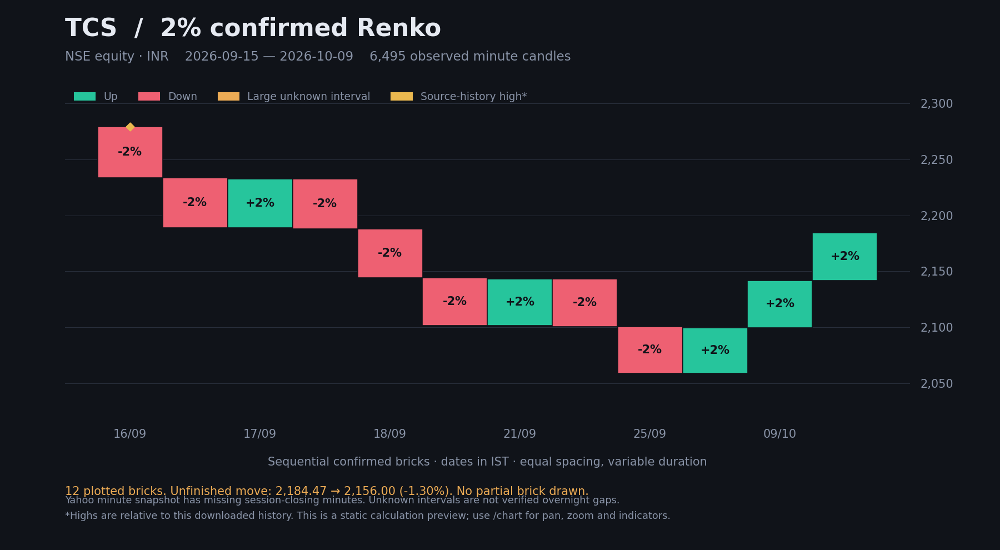

# RealRenko — confirmed percentage / ATR bricks for NSE stocks and NIFTY

## Version 2.5: stock downloads and threshold-only normal bricks

Download **TCS, RELIANCE, INFY, HDFCBANK, M&M**, or another NSE equity supported
by Yahoo Finance. The symbol accepts an optional `.NS` suffix. Stock prices
can have opening gaps too; selecting a stock does not remove them.

The default **Confirmed moves** view carries unfinished movement across minutes
and sessions. It draws a normal brick only when the selected threshold is met.
The earlier **Daily remainders** view is still available in the Bricks selector.

### Run TCS

Python 3.10+, from the repository directory:

```bash
python -m pip install -r requirements.txt
python nifty_bars.py --symbol TCS --download --days 28 --serve
```

Open **http://127.0.0.1:8000/chart?symbol=TCS&percentage=2**.
For an existing checkout, stop the server, run `git pull --ff-only`, then restart.

In the chart, enter a symbol and press **Download & plot**. **Load saved** opens
its cached snapshot without contacting the provider. Pan, zoom, crosshair,
log scale, Supertrend, EMA, SMA, ATR sizing and source-high markers all work
with the selected instrument. **Daily price trend** / **Daily candles** show
observed daily prices rather than synthetic Renko boundaries. The interface
uses vendored TradingView Lightweight Charts; it is not TradingView's full app.

To load the original user-supplied NIFTY history:

```bash
python nifty_bars.py --download --serve
```

Select `NIFTY50` and **Load saved**. Its original source is
[sandeepkapri/Nifty50-Minute-Data](https://github.com/sandeepkapri/Nifty50-Minute-Data).

### The exact percentage rule

For anchor `A` and percentage `p` (`2` means 2%):

```python
upper = A * (1 + p / 100)
lower = A * (1 - p / 100)
```

Completed minute closes confirm normal bricks. Emit **every** crossed threshold,
then carry the remaining displacement from the last brick boundary. Each
normal body is exactly `+p%` or `-p%` of its **own open**, using Decimal before
JSON serialization. Bricks compound; two upward 2% bricks span 4.04%, not 4%.
Reversals use one brick, rather than traditional two-brick Renko reversal.

At a session boundary, compare the opening change with the **previous observed
close**, not with the unfinished brick's anchor:

- **Below the threshold:** treat the observed open as ordinary movement toward
  the pending brick. If it completes the threshold, confirm a normal brick at
  the open. There is **no separate gap label or gap bar**.
- **At or above the threshold:** print any preceding nonzero unfinished move
  as a **pre-gap remainder**, then one bar preserving the complete opening gap.
  Restart the anchor at the new observed open. Never subtract the preceding
  remainder from the actual gap or round a large gap to the brick percentage.
- No ordinary session-end, flat-session or final partial is plotted. Unfinished
  movement appears in the inspector and `metadata.pending_move`, outside the
  bar series. It is excluded from chart indicators until a brick is confirmed.

Examples at **2%**, starting from anchor 100:

| Observed prices | Plotted result |
| --- | --- |
| Close 101 | No brick; 1% remains pending |
| Close 101, next open 103 | One **normal** 100 → 102 brick at the open; 1 price unit remains pending |
| Close 101, next open 103.02 | A 100 → 101 remainder, then an exact 2% gap 101 → 103.02 |
| Close 101, next open 104.03 | A 100 → 101 remainder, then the full **3%** gap 101 → 104.03 |
| Close 99, next open 98 | One normal downward 100 → 98 brick |
| Minute closes at 107 | Three normal bricks: 100 → 102 → 104.04 → 106.1208; remainder stays pending |

The 101 → 103 opening change is ~1.9802%; it therefore joins the normal move.
An opening-confirmed brick uses only the observed open and prior history; the
current minute's later high and close cannot affect it. `known_at` records the
actual confirmation time. Several bricks from one observation can share that
time. The calculated brick boundary is not a promised trade execution price.

### Missing data and source limits

`stock_data.py` requests genuine **1-minute** OHLC from Yahoo's unofficial chart
endpoint. It uses requests of at most seven days within a recent **28-calendar-day**
window. This respects the [limits documented in yfinance's own tests](https://github.com/ranaroussi/yfinance/blob/main/tests/test_price_repair.py).
Older minute history and every NSE symbol are not guaranteed. There are no
credentials, subscriptions or new production dependencies. Provider errors and
rate limits are reported; the app never substitutes daily bars for minutes.

Downloads keep completed regular-session candles (09:15–15:29 Asia/Kolkata).
Null OHLC rows, unfinished candles and outside-session quotes are excluded and
counted. Invalid prices, wrong symbols, conflicting duplicates or wrong
intervals reject the refresh. No forward filling, price rounding or local
split/dividend adjustment is applied. Provider corporate actions are retained
in metadata; splits and dividends can affect price comparisons.

A gap is classified `session_gap` only with observed 15:29 → 09:15 endpoints.
Otherwise the unobserved interval is **not a verified overnight gap**. Its
endpoint movement can complete ordinary bricks below the threshold; the bar's
`confirmation` identifies an opening after missing data. At/above the threshold
it becomes a `data_gap` bridge. No traded path through missing minutes is claimed.
Metadata counts absorbed unknown intervals and flags incomplete sessions.

Each stock has a separate immutable CSV snapshot under ignored `data/`.
An atomic manifest publishes the download only after all chunks validate.
Refresh replaces the recent window; it does not append across possible provider
adjustments. Old snapshots remain on disk, and a failed refresh leaves the
previous manifest intact. The app checks the snapshot hash before reading it.
The source, exact downloaded dates, skipped records and SHA-256 are recorded.

### Actual TCS validation

Downloaded on **10 October 2026**, the snapshot contained **6,495 valid minutes**
from **15 September to 9 October 2026**, across 18 observed sessions. Yahoo
returned 255 null OHLC rows, including missing session-closing minutes. These
were not filled. All 17 inter-session endpoint changes were below 2%, so they
were incorporated into normal movement, not plotted as gap bars.

The 2% result has **12 completed normal bricks**. The final observed price is
2,156.00, with an unfinished -1.30345% displacement from anchor 2,184.473539.
That unfinished move is not a bar. Exact brick bodies, connected boundaries,
source-minute accounting and source-high event accounting were checked.
This audit verifies conversion of the downloaded data, not its independent
accuracy against exchange records. See [audit JSON](examples/tcs_2pct_validation.json).



### ATR sizing and indicators

Choose **Sizing → ATR · daily**, with length **7, 10, 14 or any positive integer**.
ATR uses actual daily source OHLC, not synthetic brick prices:

```text
TR = max(H − L, abs(H − previous eligible close), abs(L − previous eligible close))
first TR = H − L
seed ATR = mean(first N eligible daily TRs)
next ATR = (previous ATR × (N − 1) + TR) / N
```

Only fully observed 375-minute regular sessions are eligible. The prior daily
ATR becomes the next session's fixed point size; the current session cannot
resize earlier bricks. Incomplete days are skipped. Threshold mode carries
pending movement during warm-up; no invented full ATR bricks are drawn.

**This TCS snapshot has no complete sessions, so daily ATR sizing cannot warm
up on it.** The chart says so. Use a more complete minute CSV for reliable
ATR sizing; selecting 7 instead of 14 does not repair missing source minutes.
The earlier NIFTY source does have eligible daily history. A custom period
still requires that many eligible prior daily candles.

Supertrend's ATR setting is separate: it uses the displayed bar sequence
(bricks/remainders/gap bridges, or observed daily OHLC in a daily view). EMA and
SMA also use that selected series. Indicators warm up before date filtering.
Gold **ATH*** markers mean a new **source-history high**, not a verified lifetime
high. The first source high seeds the baseline; equal highs do not qualify.
Pending source-high observations are attached when a brick is confirmed.

### Python, CLI and API

```python
from stock_data import download_stock
from nifty_bars import read_minutes, convert_minutes

path, source = download_stock("TCS", days=28)
result = convert_minutes(read_minutes(path, expected_instrument="TCS"), percentage=2)
result["metadata"].update(source)
```

```bash
# Export from a saved download; --html produces the standalone Plotly export.
python nifty_bars.py --symbol TCS --percentage 2 --output bars.json --html bars.html
# A complete CSV can also be supplied directly in the schema below.
python nifty_bars.py --csv my_tcs.csv --symbol TCS --sizing atr --atr-period 14
# Retain the earlier daily partials / every opening gap behavior.
python nifty_bars.py --symbol TCS --percentage 2 --session-mode daily
```

- `POST /download?symbol=TCS&days=28` — explicit download/refresh.
- `GET /bars?symbol=TCS&percentage=2` — confirmed percentage bricks.
- `GET /bars?symbol=TCS&sizing=atr&atr_period=14` — daily ATR sizing.
- `GET /bars?symbol=TCS&percentage=2&session_mode=daily` — legacy daily remainders.
- `GET /history?symbol=TCS` — observed daily OHLC.
- `GET /docs` — interactive API documentation.

`start` and `end` are inclusive IST date filters applied **after** conversion,
not requests for older Yahoo history. `include_partials=false` hides explicit
pre-gap remainders (or legacy daily remainders), so it can disconnect displayed
prices; the chart always includes those explicit remainders. Pending metadata
reports the end of the complete source, even when the displayed dates are filtered.

CSV schema: `Instrument,Date,Time,Open,High,Low,Close`, with `DD-MM-YYYY` dates
and `HH:MM:SS` IST minute-start times. A file must contain exactly one instrument
and sorted raw timestamps. The original NIFTY file's nonzero-second labels are
floored and collisions explicitly merged first/max/min/last, with counts reported.

Run `uvicorn main:app --host 127.0.0.1 --port 8000` for the ASGI entry point.
Optional environment variables: `NIFTY_CSV`, `STOCK_DATA_DIR`, `DEFAULT_SYMBOL`.
Use `--data-dir` to select another stock cache directory in the CLI.

### Validation

```bash
python -m pip install -r requirements-dev.txt
python -m unittest -v
npm ci
npm test
python validate_stock_source.py --symbol TCS --percentage 2
# Optional static preview (requires matplotlib):
python validate_stock_source.py --symbol TCS --percentage 2 --plot examples/tcs_2pct.png
```

The tests cover threshold boundary examples in both directions, opening-price
confirmation without look-ahead, small gaps as normal movement, large gap
preservation, missing intervals, CSV identity, download failures, symbol cache
isolation, and chart controls. Frontend DOM tests stub the chart engine; renderer
geometry tests inspect canvas calls, not physical browser gestures.
The older full-source audit scripts deliberately retain `session_mode=daily`.
[Version 2.3 documentation](docs/version-2.3.md) is archived for that policy.
